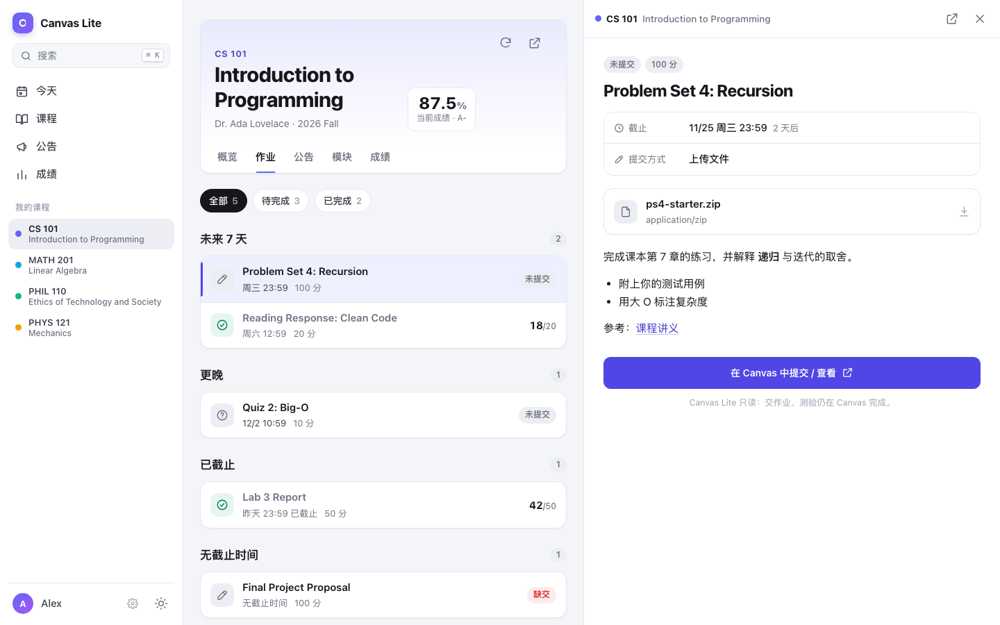
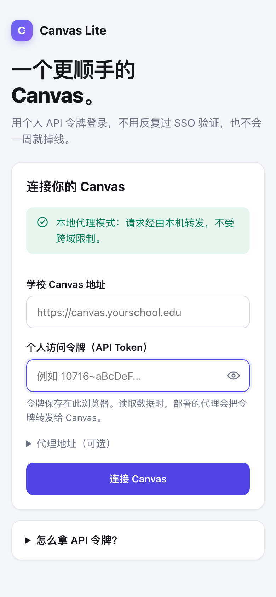
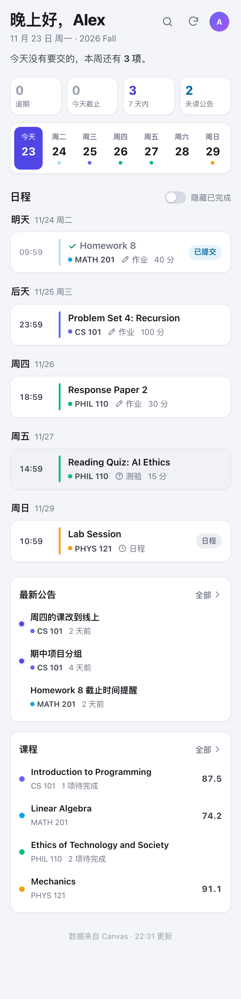
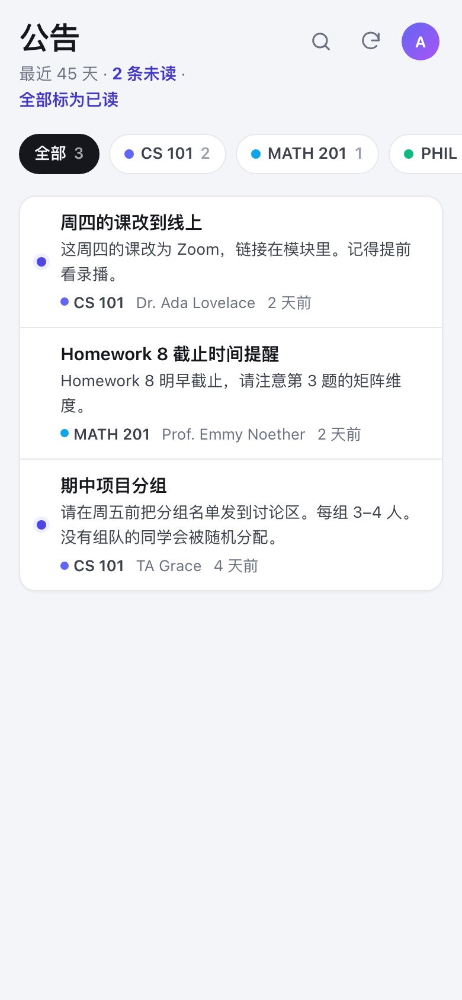
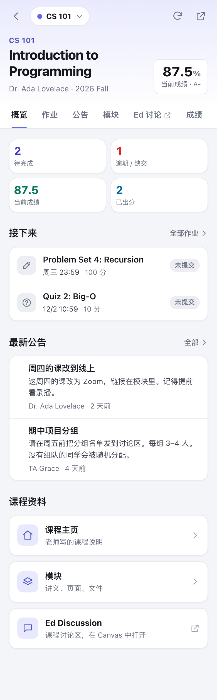
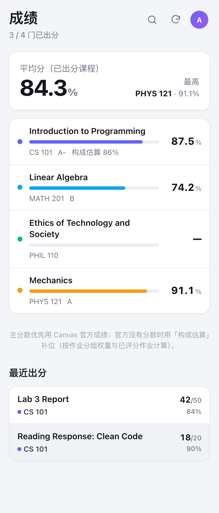
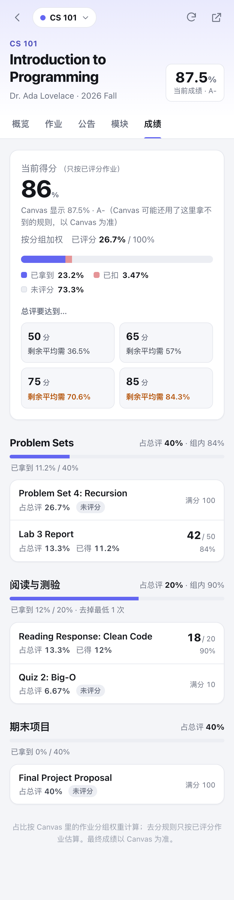
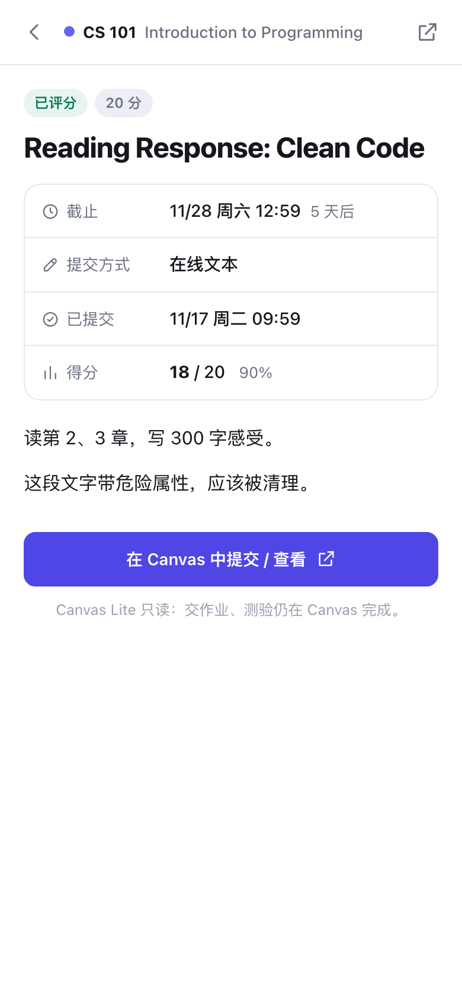
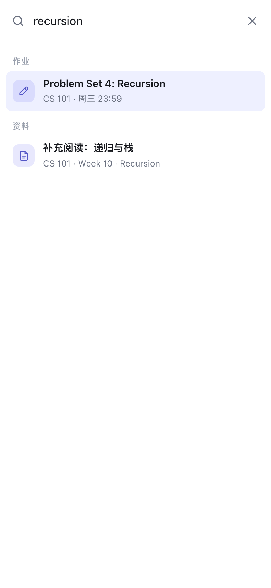

# Canvas Lite 使用说明（给不写代码的人）

Canvas Lite 是一个用「API 令牌」登录 Canvas 的网页。打开就能看今天要交什么、各门课的作业、公告、课件和成绩。不用每次过学校的验证，也不会像手机 App 那样一周就过期。手机和电脑都能用。

> 这份说明假设已经有人帮你把 Canvas Lite 部署好了，你手上有一个网址（通常形如 `https://xxx.pages.dev`）。如果还没有，请把 [README](README.md) 里「部署到自己的 Cloudflare Pages」一节转给会操作电脑的朋友。

---

## 第一次使用：3 步

### 1. 打开网址

手机用 Chrome / Safari，电脑用任意浏览器，打开别人给你的网址。如果部署时设好了学校地址，「学校 Canvas 地址」一栏已经填好；没填的话，填你平时登录 Canvas 时浏览器地址栏里 `https://` 开头到第一个 `/` 之前的那一段，例如 `https://canvas.example.edu`。

### 2. 拿到 API 令牌并粘贴

1. 用浏览器登录学校 Canvas
2. 左上角 **Account（账户）** → **Settings（设置）**
3. 找到 **Approved Integrations（已批准的集成）** → **+ New Access Token**
4. 名称随便填（比如 `Canvas Lite`），**Expires（过期时间）留空**，点 **Generate Token**
5. 复制那一长串字符，粘贴到「个人访问令牌」那一栏

「代理地址（可选）」不用管，保持空着。

> 找不到 **+ New Access Token** 按钮？说明你们学校不允许学生自己创建令牌，这个工具就用不了了。

### 3. 点「连接 Canvas」

看到「今天」页面就成功了。令牌记在这台设备的浏览器里，以后不用再填。**每台设备（手机、电脑）各需要粘贴一次。**

---

## 装到手机桌面（像 App 一样）

- **安卓 Chrome**：右上角 **⋮** → **添加到主屏幕**
- **iPhone Safari**：底部分享按钮 → **添加到主屏幕**

以后点桌面图标就能全屏打开，断网时也能看到上次的数据。

---

## 界面一览

**手机**：底部四个标签 **今天 / 课程 / 公告 / 成绩**；右上角是搜索（放大镜）、刷新和头像（点头像进「设置」）。点开作业、公告会全屏显示，左上角 **←** 返回，回来还停在原来的位置。

**电脑**：左边是侧栏，有四个标签和所有课程，左下角是头像（设置）和外观切换。屏幕够宽时，点开的作业、公告出现在右边，左边列表不动，可以一个个往下点；按 **Esc** 或右上角 **×** 关闭。

  
  
  
  

| 页面 | 能看到什么 |
| --- | --- |
| 今天 | 逾期 / 今天截止 / 7 天内 / 未读公告四个数字；未来 7 天日期条（圆点颜色对应课程）；按天排好的作业和日程 |
| 课程 | 每门课的当前成绩和下一项要交的作业 |
| 课程详情 | 概览 / 作业 / 公告 / 模块 / 成绩 五个栏目；用 Ed 的课程多一个「Ed 讨论」入口 |
| 公告 | 所有课最近 45 天的公告，蓝点是没看过的 |
| 成绩 | 每门课的分数（Canvas 还没给分时显示「估算」）、平均分、最近出分的作业 |
| 设置 | 账号、浅色 / 深色、隐藏已完成、强制更新、退出登录、帮助 |

---

## 平时怎么用

| 想做的事 | 怎么做 |
| --- | --- |
| 看今天 / 本周要交什么 | 「今天」：点日期条上的某一天，直接跳到那天 |
| 只看还没做的 | 「今天」→ 打开「隐藏已完成」 |
| 先处理逾期的 | 「今天」最上面红色的「已逾期」一组 |
| 看所有课的新公告 | 「公告」：可以按课程筛选，看完点「全部标为已读」 |
| 看某门课的作业 | 课程 → 点课程 → 作业（可以筛「待完成」「已完成」） |
| 换一门课看同一栏 | 手机：课程页左上角点课程代码，选另一门；电脑：直接点侧栏里的课程 |
| 看课程主页 | 课程 → 概览 → 「课程主页」 |
| 去 Ed Discussion 讨论区 | 课程 → 点课程 → 栏目条「模块」旁边的「Ed 讨论」，或概览最下面的「Ed Discussion」卡片（只有用 Ed 的课程才有；会在新标签页经 Canvas 打开，浏览器要登录过 Canvas） |
| 看课件、模块 | 课程 → 模块（「全部展开 / 收起」一次打开所有模块） |
| 下载课件 | 课程 → 模块 → 点文件（直接下载，不用跳 Canvas） |
| 找某个作业 / 公告 / 资料 | 右上角放大镜（电脑按 `/` 或 `Ctrl + K`），输入几个字 |
| 看每项作业占多少、已经拿了多少 | 课程 → 成绩：每项写着「占总评 x%」「已得 y%」，最上面是当前得分 |
| 算还要拿多少分 | 课程 → 成绩 →「总评要达到…」：剩下的作业平均要拿多少才能到 50 / 65 / 75 / 85 分 |
| 交作业、考试、讨论 | 作业详情底部「在 Canvas 中提交 / 查看」（Canvas Lite 只能看，不能交） |
| 换深色模式 | 设置 → 外观；电脑侧栏左下角的小按钮也能切 |
| 换账号 | 头像 → 设置 → 退出登录 |
| 数据不是最新的 | 右上角刷新按钮 |

  
  
  

> 成绩里的「占总评」和「估算」是按 Canvas 里老师设置的作业分组权重算出来的。老师没在 Canvas 设权重时只能按分值折算，可能和课程大纲不一样，**以课程大纲和 Canvas 为准**。

---

## 遇到问题

| 看到什么 | 怎么办 |
| --- | --- |
| 样子还是旧版，或者页面空白 | 头像 → 设置 →「强制更新到最新版」，等页面自动重开 |
| 「令牌无效或已过期」 | 令牌没复制完整，或者被撤销了。回 Canvas 重新生成一个（Expires 留空），「设置 → 退出登录」后重新填 |
| 「登录页的 Canvas 地址必须与站点配置的 CANVAS_ORIGIN 一致」 | 学校地址填错了。「设置 → 退出登录」，用登录页预填的地址重新登录 |
| 「请在 Cloudflare Pages 设置中配置 CANVAS_ORIGIN」 | 网站还没设置好，把这句话发给帮你部署的人 |
| 「请求太频繁」 | Canvas 有请求次数限制，等几分钟再刷新 |
| 「公告暂时没加载出来」 | 点右上角刷新。还不行就把提示文字发给帮你部署的人，其他页面不受影响 |
| 「今天」的时间线是空的 | 可能真的没有要交的；也可能学校关了 Planner，这时只显示 Canvas 待办里的作业 |
| 作业附件打不开 | 附件链接是临时的，关掉作业再点开一次 |
| 标题旁显示「离线」 | 断网时显示的是上次的数据，联网后点刷新 |
| 搜不到某个作业 | 搜索只查已经加载过的内容。先点进那门课看一眼，再搜 |

---

## 安全提醒

- 令牌等于你账号的钥匙，**不要发给别人、不要截图发群**
- 令牌只存在你自己设备的浏览器里。查数据时，令牌会经过网站自带的代理转发给学校 Canvas；代理只能读，不保存令牌。**所以只用你自己或信得过的人部署的网址**
- 公共电脑上用完，记得「设置 → 退出登录」
- 不用了可以回 Canvas → Settings → Approved Integrations，把令牌 **Delete** 掉
